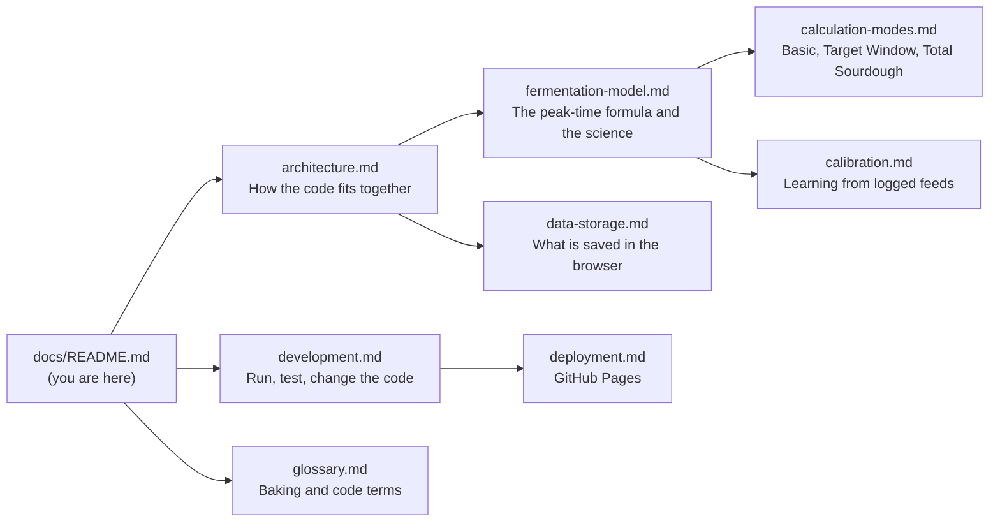

# Sourdough Peak Planner documentation

The Sourdough Peak Planner tells a baker **when their sourdough starter will peak** (be at its most active) after a feeding, and **how to feed it** so it peaks at a time they choose.

These docs explain how the app works, why the calculation looks the way it does, and how to change it safely. They are written for developers at any level, including people new to React or to sourdough, and for AI coding agents.

## Where to start

| You are… | Read in this order |
|---|---|
| New to the project | [Architecture](architecture.md) → [Development](development.md) → [Glossary](glossary.md) |
| Changing the timing calculation | [Fermentation model](fermentation-model.md) → [Calculation modes](calculation-modes.md) → [Calibration](calibration.md) |
| Changing what is saved in the browser | [Data and storage](data-storage.md) |
| Publishing the app | [Deployment](deployment.md) |
| An AI agent | [`AGENTS.md`](../AGENTS.md) in the repo root, then the page for your task |

## Map of the docs

## The app in one paragraph

Everything runs in the browser. There is no server and no login. The baker describes their starter (flour blend, feeding ratio, temperature, optional sugar) and the app calculates the time to peak with one formula in [`src/lib/sourdough-calculator.ts`](../src/lib/sourdough-calculator.ts). Starters, settings and a feeding history are saved in the browser's `localStorage`. When the baker records when their starter really peaked, the app learns a correction for that starter and uses it for later predictions. The app is built with Vite, React and TypeScript, styled with Tailwind CSS and shadcn/ui components, and published to GitHub Pages.

## Conventions used in these docs

- File paths are relative to the repository root and link to the file, for example [`src/App.tsx`](../src/App.tsx).
- Code names (functions, constants, types) are written like `calculateFeedingSchedule`.
- Numbers in tables were produced by running the real calculator, not by hand. If you change a constant, update the tables (see [Development → Updating the docs](development.md#updating-the-docs)).
- Diagrams use [Mermaid](https://mermaid.js.org/), which GitHub draws automatically. Each diagram is also explained in text, so nothing depends on seeing the picture.
