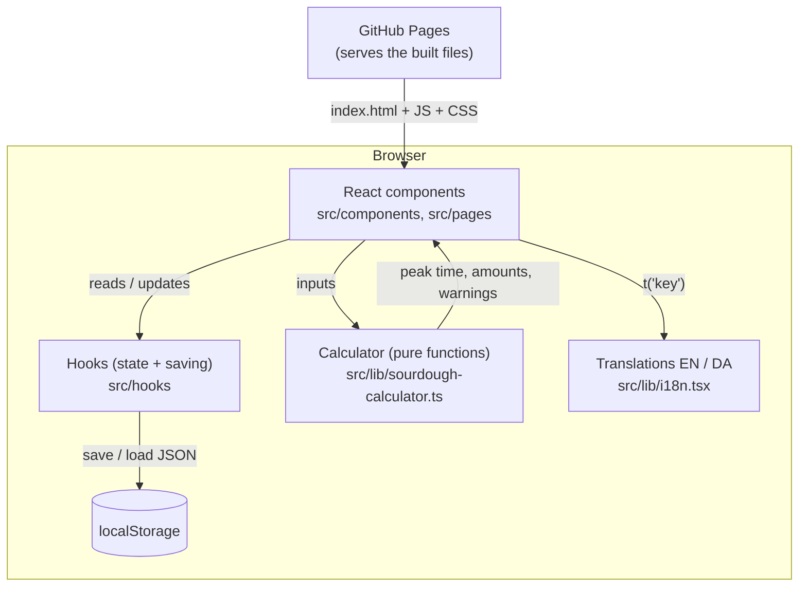
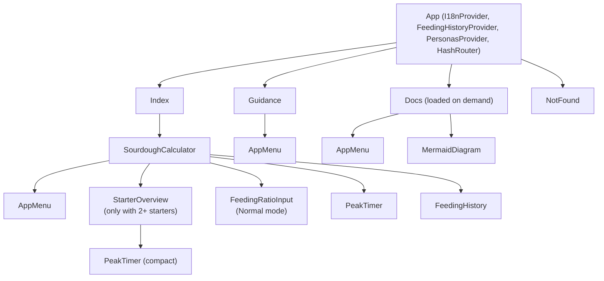
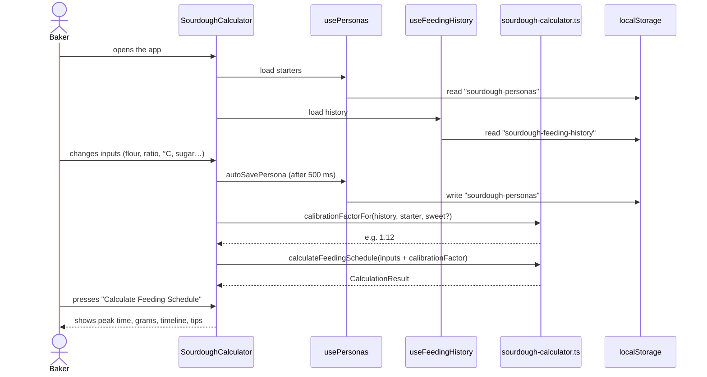

# Architecture

This page explains how the code is organised and how data moves through the app. After reading it you should know which file to open for any change.

## The big picture

The app is a **single-page application (SPA)**: one HTML page that React fills in and updates in the browser. There is no backend. All logic and all data live in the browser.



In words:

1. GitHub Pages sends the browser the built files (one `index.html`, one JavaScript file, one CSS file).
2. React components draw the screen. They keep their state in **hooks**, and the hooks save that state to `localStorage` so it survives a reload.
3. When the baker presses **Calculate Feeding Schedule**, the component passes the current inputs to the **calculator**, which returns the peak time, gram amounts and warnings.
4. All visible text comes from the translation table through `t('someKey')`.

The calculator has **no React and no browser code**. It takes plain values in and returns plain values out. That makes it easy to test (see [Development](development.md#tests)) and safe to change without touching the UI.

## Folder layout

```text
.
├── AGENTS.md                      Instructions for AI coding agents
├── docs/                          This documentation
├── .github/workflows/
│   └── deploy-pages.yml           Deploys a chosen branch to GitHub Pages
├── index.html                     The single HTML page
├── vite.config.ts                 Build config (base path "./", "@" alias → src)
├── package.json                   Scripts: dev, build, lint, test, preview
└── src/
    ├── main.tsx                   Entry point: mounts <App /> into #root
    ├── App.tsx                    Providers + routes (HashRouter)
    ├── pages/
    │   ├── Index.tsx              "/"            → the calculator
    │   ├── Guidance.tsx           "/guidance"    → how-to page for bakers
    │   ├── Docs.tsx               "/docs/:page"  → these docs, rendered from /docs/*.md
    │   └── NotFound.tsx           anything else
    ├── components/
    │   ├── AppMenu.tsx               Fold-out menu: manage starters, open the docs
    │   ├── MermaidDiagram.tsx        Draws a Mermaid diagram on a docs page
    │   ├── SourdoughCalculator.tsx   The main screen: inputs, results, history
    │   ├── FeedingRatioInput.tsx     Starter : flour : water input (ratio or grams)
    │   ├── PeakTimer.tsx             Countdown to the predicted peak
    │   ├── StarterOverview.tsx       All starters and their peak times
    │   ├── FeedingHistory.tsx        Logged feeds, record the actual peak
    │   └── ui/                       shadcn/ui building blocks (Button, Card, Slider…)
    ├── hooks/
    │   ├── use-personas.ts           Starters ("personas"): create, edit, save
    │   ├── use-feeding-history.ts    Logged feeds and accuracy stats
    │   ├── use-calculator-cache.ts   App settings (dark mode)
    │   └── use-wake-lock.ts          "Keep screen on"
    ├── lib/
    │   ├── sourdough-calculator.ts       ★ The fermentation model and schedule
    │   ├── sourdough-calculator.test.ts  Tests for the model (npm test)
    │   ├── docs.ts                       Docs pages list, link and heading helpers
    │   ├── docs.test.ts                  Checks every link inside the docs
    │   ├── i18n.tsx                      English and Danish texts
    │   └── utils.ts                      cn() helper for CSS classes
    ├── types/sourdough.ts            Shared TypeScript types
    └── integrations/supabase/        Generated by Lovable, not used by the app
```

## Screens and routes

The app uses `HashRouter`, so the route is the part of the URL after `#`. This lets every page work on GitHub Pages without server configuration (see [Deployment](deployment.md#why-the-urls-have-a-)).

| URL | Component | What it shows |
|---|---|---|
| `/#/` | [`pages/Index.tsx`](../src/pages/Index.tsx) → `SourdoughCalculator` | The calculator |
| `/#/guidance` | [`pages/Guidance.tsx`](../src/pages/Guidance.tsx) | Explanation of modes, flours and temperature for bakers |
| `/#/docs`, `/#/docs/<page>` | [`pages/Docs.tsx`](../src/pages/Docs.tsx) | These docs. `?section=<heading>` jumps to a section |
| anything else | [`pages/NotFound.tsx`](../src/pages/NotFound.tsx) | "Page not found" with a link home |

## Component tree

`SourdoughCalculator` is the main component. It owns almost all state and passes values down to smaller components.



**Starters are managed in the menu.** `AppMenu` (☰, top left on every page) selects, adds, renames, duplicates and deletes starters, and links to the calculator, the guidance page and every docs page. Delete asks for a second tap. The main page only shows the active starter's name.

The input cards (flour blend, mode, start time, old sourdough, ratio, temperature, target window, sweet sourdough, keep screen on) are written directly inside `SourdoughCalculator.tsx`. So is the results column (schedule, recommended ratio, fermentation timeline, suggestions).

## How one calculation flows

This is what happens from opening the app to seeing a peak time.



Two details that surprise new developers:

- **The result is calculated on every change**, inside a `useMemo`. The Calculate button only makes the results column visible (`showResults`), and they then update live as the baker changes inputs.
- **The form is copied from the saved starter only when switching starters.** The effect that does this depends on `activePersonaId` alone. If it also ran after every auto-save, it would hide the results and overwrite half-typed values like `11,`; that was a bug, fixed by narrowing the dependency.

## Where state lives

| State | Owner | Saved? |
|---|---|---|
| Starters (flour blend, ratio, temperature, sugar, time settings) | `PersonasProvider` in `App.tsx`, read with `usePersonas` | Yes, `sourdough-personas` |
| Which starter is selected | `PersonasProvider` | Yes, `sourdough-active-persona` |
| Logged feeds and recorded peaks | `FeedingHistoryProvider` in `App.tsx`, read with `useFeedingHistory` | Yes, `sourdough-feeding-history` (latest 50) |
| Dark mode | `useCalculatorSettings` | Yes, `sourdough-calculator-settings` |
| Form values while editing | `useState` in `SourdoughCalculator`, copied from the active starter | Through auto-save |
| Language | `I18nProvider` in `App.tsx` (one for the whole app) | Yes, `sourdough-language` |
| Results visible, timer reset key | `useState` in `SourdoughCalculator` | No |

Details of every saved field are in [Data and storage](data-storage.md).

**State that several components need must have one owner.** The feeding history is used by `SourdoughCalculator` (log feeds, calibration) and `FeedingHistory` (show feeds, record peaks). Each used to call the hook and get its **own copy**: a logged feed did not appear in the history card until a reload, and recording a peak saved the card's old copy over the newer one, deleting the feed just logged. Now `FeedingHistoryProvider` holds the one copy and `useFeedingHistory()` reads it. Starters work the same way (`PersonasProvider` / `usePersonas()`), because the menu and the calculator both change them. Do the same for any new state shared between components.

## Translations

All text shown to the baker is in [`src/lib/i18n.tsx`](../src/lib/i18n.tsx). One `I18nProvider` in `App.tsx` wraps every page and remembers the chosen language in `localStorage`. The texts are in two objects: `translations.en` and `translations.da`. Components call `t('key')`. If a key is missing in Danish, the English text is used; if it is missing in both, the key itself is shown.

Flour and sugar names are looked up by their type key (for example `t('spelt-whole')`), and flour descriptions by `'<key>-desc'`. When you add a flour or sugar type, add these keys in **both** languages.

Many calls are written `t('key' as any)`. That cast is why `npm run lint` reports `no-explicit-any` errors. They were there before the docs were written and are harmless.

## Libraries in use

| Library | Used for |
|---|---|
| React 18 + TypeScript | UI and types |
| Vite 5 | Dev server and build |
| React Router 6 (`HashRouter`) | The three routes |
| Tailwind CSS + shadcn/ui (Radix UI) | Styling and accessible components |
| lucide-react | Icons |
| sonner | "Feeding logged" toast messages |
| react-markdown + remark-gfm | Rendering the docs pages (with tables) |
| mermaid | Drawing the diagrams in the docs |
| @tailwindcss/typography | `prose` styles for the docs pages |

The docs page, react-markdown and mermaid are **loaded only when a docs page is opened** (`lazy()` in `App.tsx`, `import('mermaid')` in `MermaidDiagram`), so the calculator does not get bigger.

`src/components/ui/` contains about 50 shadcn/ui components, but the app only uses a handful (button, card, input, label, select, slider, switch, badge, toast, tooltip). The rest came with the Lovable template. `@supabase/supabase-js` and `src/integrations/supabase/` are also template leftovers: nothing imports the client.

## Lovable

The project was started in [Lovable](https://lovable.dev), an AI app builder that can push commits to this repository. That is why the README used to be Lovable boilerplate and why some generated files exist. You do not need Lovable to work on the code.
