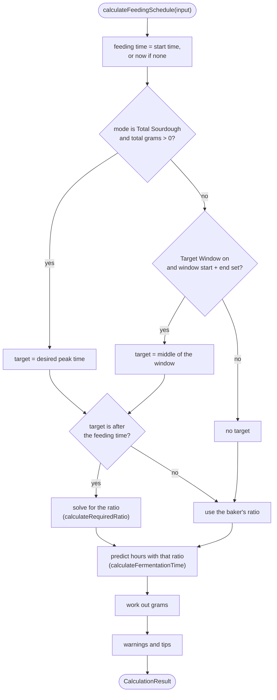
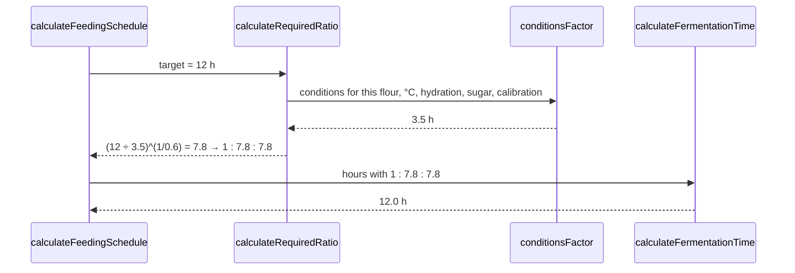

# Calculation modes

The baker picks one of three modes in the **Calculation Mode** card. All three use the same [fermentation model](fermentation-model.md). They differ in what the baker gives and what the app works out.

| Mode (UI label) | Code value (`InputMode`) | Baker gives | App works out |
|---|---|---|---|
| **Normal** | `'basic'` | Start time, starter grams, feeding ratio | When it will peak |
| **Target Window** | `'target-window'` | Start time, starter grams, a window for the peak | The feeding ratio that peaks in the middle of the window |
| **Total Sourdough** | `'total-sourdough'` | Total grams wanted, start time, one peak time, available starter | The ratio, and grams of starter, flour and water |

Temperature, flour blend and sweet sourdough apply in every mode.

All three are handled by one function, `calculateFeedingSchedule(input)` in [`src/lib/sourdough-calculator.ts`](../src/lib/sourdough-calculator.ts), which returns a `CalculationResult` (see [`src/types/sourdough.ts`](../src/types/sourdough.ts)).

## How the function decides



Important: **the predicted peak is always what the chosen ratio really gives.** If the target can't be reached, the app does not pretend it can; it shows the closest it can get and a warning. (An earlier version silently set the peak to the middle of the window.)

## Normal mode

The simplest case. The baker sets the start time, how much old starter they have, and the ratio. The app predicts the peak.

**Example:** 50 g starter, 1:1:1, all-purpose flour, 24 °C, fed at 20:00.
→ 50 g flour, 50 g water, 150 g in total, peak at **23:30** (3.5 h).

Amounts: `flour = starter × (flour part ÷ starter part)`, and the same for water. The feeding ratio can be typed as parts or as grams in `FeedingRatioInput`.

## Target Window mode

The baker wants the peak inside a window, for example between 07:00 and 09:00 tomorrow, so it is ready when they wake up. The app aims for the **middle** of the window and calculates the ratio needed.

**Example:** 50 g starter, all-purpose, 24 °C, fed at 20:00, window 07:00–09:00.
→ target 08:00 = 12 h away → recommended ratio **1 : 7.8 : 7.8** → 390 g flour, 390 g water, peak at **08:00**.

The ratio card is hidden in this mode, but the **hydration** of the starter's saved ratio is kept: if the starter is normally fed 1:1:0.6, the recommendation keeps 60 % water.

If the window cannot be reached, for example only 1–1.5 h away, the app uses the closest allowed ratio (1:0.5:0.5), shows the real peak time (22:18 in that example, 2.3 h), and shows a red **"Target time not achievable"** box with the shortest possible time.

## Total Sourdough mode

The baker knows how much starter they need for a recipe, for example 200 g, and when they need it. The app finds the ratio for that peak time and splits the total into starter, flour, water and sweetener.

**Example:** 200 g wanted, all-purpose, 24 °C, fed at 20:00, peak wanted at 02:00 (6 h).
→ ratio **1 : 2.5 : 2.5** → 33 g starter, 83 g flour, 83 g water (199 g after rounding), peak at **02:03**.

If the baker has less old starter than needed (the **Old Sourdough** field), the app uses all of it and scales flour and water down to match, and adds a tip. With only 20 g old starter in the example above: 20 g starter, 50 g flour, 50 g water, 120 g in total.

With no desired peak time (or one in the past), the baker's own ratio is used.

## The ratio solver

`calculateRequiredRatio(input, targetHours)` turns the formula around. The model is:

```text
hours = conditions × (flour ÷ starter) ^ 0.6
```

where `conditions` is everything except the ratio (`conditionsFactor`: base × flour × temperature × hydration × sugar × calibration). Solving for the ratio:

```text
flour ÷ starter = (target hours ÷ conditions) ^ (1 ÷ 0.6)
```

The answer is then limited to between **0.5 and 15** parts flour per part starter, rounded to one decimal, and the water is set to keep the starter's hydration.



Because the solver and the prediction both call `conditionsFactor`, the predicted time with the recommended ratio comes back to the target (within rounding). The test "the ratio solver gives back the target time" checks this with and without sugar and calibration.

## Is the target reachable?

`checkTargetAchievability` works out the **shortest** and **longest** times possible with the current conditions, using ratios 1:0.5 and 1:15 at the starter's hydration. For all-purpose flour at 24 °C that is **2.3 h to 17.8 h**.

| Target is… | Result |
|---|---|
| sooner than the shortest time (or in the past) | warning `targetPeakTooSoon`, shows the shortest time |
| later than the longest time | warning `targetPeakTooLate`, shows the longest time |
| in between | no warning |

To reach a target outside the range, the baker can change the temperature: warmer for sooner (up to about 31 °C), cooler for later.

## What the result contains

| Field | Meaning |
|---|---|
| `feedingTime`, `estimatedPeakTime`, `hoursToReachPeak` | When to feed, when it peaks, and the hours between |
| `exceedsMaxHours` | `true` if the model says no normal peak within 48 h. The UI then hides the time, countdown and timeline |
| `starterAmount`, `flourAmount`, `waterAmount`, `sugarAmount` | Grams to use. Water is already reduced for honey or syrup |
| `sugarDelayMinutes` | Extra minutes caused by the sugar |
| `totalSourdoughAmount` | Sum of the above |
| `flourBreakdown` | Grams of each flour in the blend |
| `fermentationPhases` | Lag, rise, peak and decline with start and end times |
| `recommendedRatio` | The solver's ratio, or `null` in Normal mode |
| `achievabilityWarning`, `minAchievableHours`, `maxAchievableHours` | See above |
| `suggestions` | Translation keys for the tips list |

### Tips (`suggestions`)

| Key | When |
|---|---|
| `targetPeakTooSoon` / `targetPeakTooLate` | Target can't be reached |
| `adjustedRatioRecommendation` | Target Window mode used a recommended ratio |
| `insufficientStarterForTargetTotal` | Not enough old starter in Total Sourdough mode |
| `noPeakExpected` | Over 48 h |
| `tooHotForYeast` | Above 35 °C |
| `warmerFasterLessComplex` | 28–33 °C |
| `coolerSlowerFlavourful` | Below 18 °C |
| `sweetSlowerFermentation` | Sweet mode and the sugar slows the starter |

Each key has an English and a Danish text in [`src/lib/i18n.tsx`](../src/lib/i18n.tsx).

## In the UI

- The **Calculate Feeding Schedule** button is disabled when the flour blend doesn't add up to 100 %, or (Target Window) when the window end is not after its start, or the window start is not after the feeding time.
- The results are calculated continuously; the button only shows them. Changing any input hides them again until the button is pressed (see [Architecture](architecture.md#how-one-calculation-flows)).
- **Log Feeding** saves the feed to the history, including the calibration factor used, so the baker can later record the real peak. See [Calibration](calibration.md).
