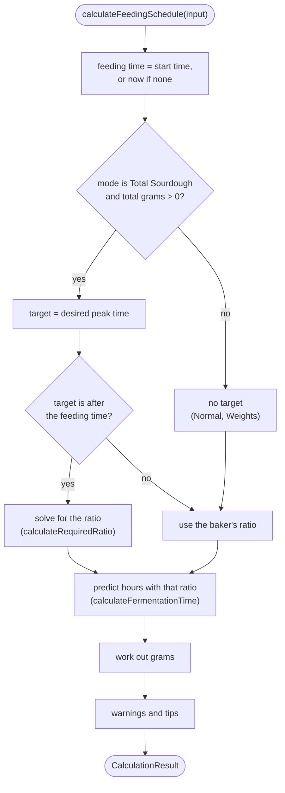
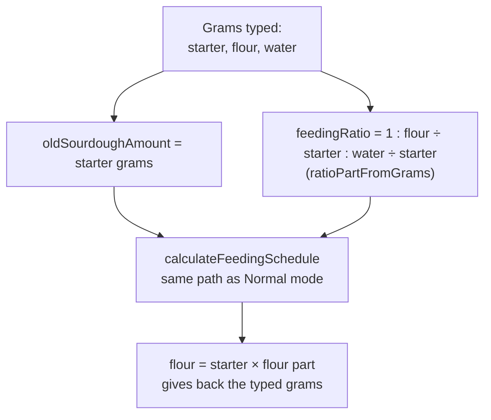
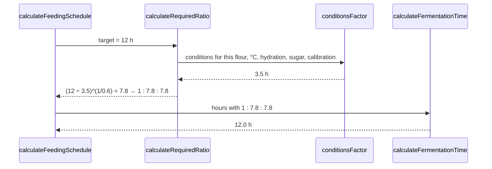

# Calculation modes

The baker picks one of three modes in the **Calculation Mode** card. All three use the same [fermentation model](fermentation-model.md). They differ in what the baker gives and what the app works out.

| Mode (UI label) | Code value (`InputMode`) | Baker gives | App works out |
|---|---|---|---|
| **Normal** | `'basic'` | Start time, starter grams, feeding ratio | When it will peak |
| **Weights** | `'weights'` | Start time, grams of starter, flour and water | The ratio those grams make, and when it will peak |
| **Total Sourdough** | `'total-sourdough'` | Total grams wanted, start time, one peak time, available starter | The ratio, and grams of starter, flour and water |

Temperature, flour blend and sweet sourdough apply in every mode.

All three are handled by one function, `calculateFeedingSchedule(input)` in [`src/lib/sourdough-calculator.ts`](../src/lib/sourdough-calculator.ts), which returns a `CalculationResult` (see [`src/types/sourdough.ts`](../src/types/sourdough.ts)).

## How the function decides



Important: **the predicted peak is always what the chosen ratio really gives.** If the target can't be reached, the app does not pretend it can; it shows the closest it can get and a warning. (An earlier version silently set the peak to the target time.)

Only Total Sourdough mode aims at a time. Normal and Weights describe a feed, and the app predicts its peak.

## Normal mode

The simplest case. The baker sets the start time, how much old starter they have, and the ratio. The app predicts the peak.

**Example:** 50 g starter, 1:1:1, all-purpose flour, 24 °C, fed at 20:00.
→ 50 g flour, 50 g water, 150 g in total, peak at **23:30** (3.5 h).

Amounts: `flour = starter × (flour part ÷ starter part)`, and the same for water. Ratio parts are typed in `FeedingRatioInput`; the grams they give are shown under them.

## Weights mode

For bakers who weigh the feed rather than think in ratios. The baker types the grams of starter, flour and water on the scale, and the app works out the ratio and the peak.

**Example:** 37 g starter, 113 g flour, 89 g water, all-purpose, 24 °C, fed at 20:00.
→ ratio **1 : 3.05 : 2.41** (79 % hydration), peak at **03:14** (7.3 h). The schedule shows 37 g, 113 g and 89 g again.

How it works: Weights mode is `FeedingRatioInput` with `showGrams`. Nothing new is stored. Typing grams sets the same two values Normal mode uses:



In words: the starter grams become `oldSourdoughAmount`, the flour and water grams become ratio parts relative to the starter, and the calculator then runs exactly as in Normal mode. Multiplying back gives the typed grams; the test "Weights mode: typed grams come back unchanged" checks this for 37/113/89 g.

- The grams are applied while typing, so the ratio and the schedule follow each keystroke, and any ratio works (13 g, 71 g, 47 g is 1 : 5.46 : 3.62). A comma or a point can be used for decimals. An empty or 0 entry goes back to the amount in use when the baker leaves the field.
- Changing the starter grams keeps the flour and water grams as typed; the ratio changes instead.
- Switching between Normal and Weights keeps the same feed: 50 g at 1:5:5 in Normal shows as 50/250/250 g in Weights.
- Honey or syrup: the water shown in the schedule is reduced by the water in the sweetener, as in the other modes.

### What happened to Target Window mode

Weights mode replaced Target Window mode (a window for the peak, from which the app recommended a ratio). Total Sourdough mode still aims at a peak time. Starters saved in Target Window mode open in Weights mode: `migratePersonas()` in [`use-personas.ts`](../src/hooks/use-personas.ts) changes the stored `'target-window'` to `'weights'`, and the grams come from the starter's saved ratio and starter amount. Restored backups go through the same function. The window times saved with those starters are ignored.

## Total Sourdough mode

The baker knows how much starter they need for a recipe, for example 200 g, and when they need it. The app finds the ratio for that peak time and splits the total into starter, flour, water and sweetener.

**Example:** 200 g wanted, all-purpose, 24 °C, fed at 20:00, peak wanted at 02:00 (6 h).
→ ratio **1 : 2.5 : 2.5** → 33 g starter, 83 g flour, 83 g water (199 g after rounding), peak at **02:03**.

If the baker has less old starter than needed (the **Old Sourdough** field), the app uses all of it and scales flour and water down to match, and adds a tip. With only 20 g old starter in the example above: 20 g starter, 50 g flour, 50 g water, 120 g in total.

With no desired peak time (or one in the past), the baker's own ratio is used.

If the peak time cannot be reached, for example only 1 h away, the app uses the closest allowed ratio (1:0.5:0.5; 100 g starter, 50 g flour, 50 g water for 200 g), shows the real peak time (22:18 in that example, 2.3 h), and shows a red **"Target time not achievable"** box with the shortest possible time. The warning is only shown in that box, not in the tips list.

## The ratio solver

`calculateRequiredRatio(input, targetHours)` turns the formula around. The model is:

```text
hours = conditions × (flour ÷ starter) ^ 0.6
```

where `conditions` is everything except the ratio (`conditionsFactor`: base × flour × temperature × hydration × sugar × calibration). Solving for the ratio:

```text
flour ÷ starter = (target hours ÷ conditions) ^ (1 ÷ 0.6)
```

The answer is then limited to between **0.5 and 15** parts flour per part starter, rounded to one decimal, and the water is set to keep the starter's hydration.



Because the solver and the prediction both call `conditionsFactor`, the predicted time with the recommended ratio comes back to the target (within rounding). The test "the ratio solver gives back the target time" checks this with and without sugar and calibration.

## Is the target reachable?

`checkTargetAchievability` works out the **shortest** and **longest** times possible with the current conditions, using ratios 1:0.5 and 1:15 at the starter's hydration. For all-purpose flour at 24 °C that is **2.3 h to 17.8 h**.

| Target is… | Result |
|---|---|
| sooner than the shortest time (or in the past) | warning `targetPeakTooSoon`, shows the shortest time |
| later than the longest time | warning `targetPeakTooLate`, shows the longest time |
| in between | no warning |

To reach a target outside the range, the baker can change the temperature: warmer for sooner (up to about 31 °C), cooler for later.

## What the result contains

| Field | Meaning |
|---|---|
| `feedingTime`, `estimatedPeakTime`, `hoursToReachPeak` | When to feed, when it peaks, and the hours between |
| `exceedsMaxHours` | `true` if the model says no normal peak within 48 h. The UI then hides the time, countdown and timeline |
| `starterAmount`, `flourAmount`, `waterAmount`, `sugarAmount` | Grams to use. Water is already reduced for honey or syrup |
| `sugarDelayMinutes` | Extra minutes caused by the sugar |
| `totalSourdoughAmount` | Sum of the above |
| `flourBreakdown` | Grams of each flour in the blend |
| `fermentationPhases` | Lag, rise, peak and decline with start and end times |
| `recommendedRatio` | The solver's ratio in Total Sourdough mode, or `null` in Normal and Weights mode |
| `achievabilityWarning`, `minAchievableHours`, `maxAchievableHours` | See above |
| `suggestions` | Translation keys for the tips list |

### Tips (`suggestions`)

| Key | When |
|---|---|
| `insufficientStarterForTargetTotal` | Not enough old starter in Total Sourdough mode |
| `noPeakExpected` | Over 48 h |
| `tooHotForYeast` | Above 35 °C |
| `warmerFasterLessComplex` | 28–33 °C |
| `coolerSlowerFlavourful` | Below 18 °C |
| `sweetSlowerFermentation` | Sweet mode and the sugar slows the starter |

Each key has an English and a Danish text in [`src/lib/i18n.tsx`](../src/lib/i18n.tsx).

## In the UI

- The **Calculate Feeding Schedule** button is disabled when the flour blend doesn't add up to 100 %.
- The results are calculated continuously; the button only shows them, and they then update live as inputs change. Switching to another starter hides them again.
- **Log Feeding** saves the feed to the history, including the calibration factor used, so the baker can later record the real peak. See [Calibration](calibration.md).
