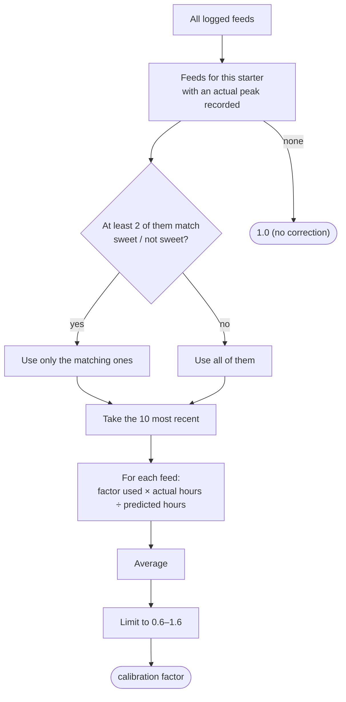
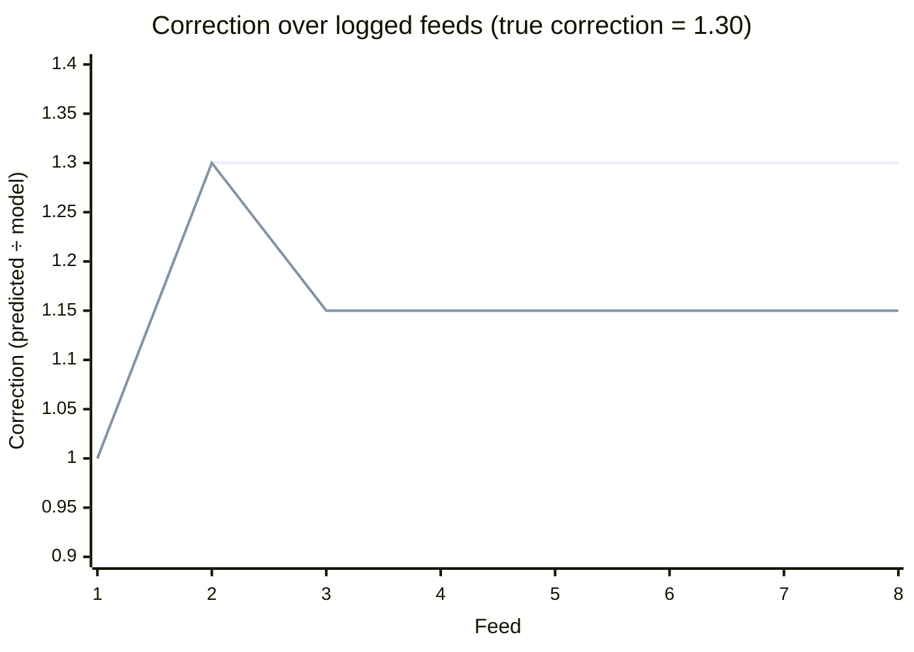
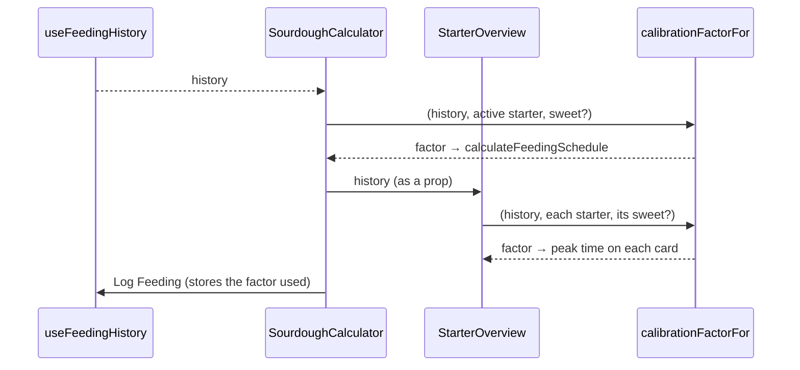

# Calibration: learning from logged feeds

Every starter is different. One may be twice as lively as another with the same flour and temperature. No formula can know that in advance, so the app **learns a correction for each starter** from feeds the baker logs.

## The baker's side

1. Calculate a schedule and press **Log Feeding**. The feed is saved with its predicted peak.
2. When the starter really peaks, open **Feeding History** and record the actual peak time.
3. The app compares the two and adjusts later predictions for that starter.

The history card also shows the average difference in minutes ("tends to peak 25 min later"), from `getAccuracyStats` in [`src/hooks/use-feeding-history.ts`](../src/hooks/use-feeding-history.ts). That number is for the baker only; the calculation uses the factor below.

## The correction is a multiplier

The calibration factor multiplies the predicted time, like every other part of the [formula](fermentation-model.md). A factor of 1.2 means "this starter takes 20 % longer than the model expects". A multiplier, not a fixed number of minutes, because a starter that is 20 % slow is 40 min late on a 3.5 h feed but over 2 h late on a 12 h feed.

The factor is limited to **0.6–1.6** (`CALIBRATION_MIN`, `CALIBRATION_MAX`) so one badly recorded peak can't wreck all later predictions.

## How the factor is calculated

`calibrationFactorFor(history, personaId, isSweet)` in [`src/lib/sourdough-calculator.ts`](../src/lib/sourdough-calculator.ts):



Hours are measured from the feeding time. A feed is "sweet" if it had sugar (`sugarAmount > 0`).

### Why "factor used × actual ÷ predicted"?

Each logged feed stores the **factor its prediction already used** (`calibrationFactor` in the entry). The predicted time already includes that correction, so:

```text
what this feed says the factor should have been = factor used × actual hours ÷ predicted hours
```

**Example.** The model alone says 4 h, but this starter really takes 5.2 h (true factor 1.3).

| Feed | Factor used | Predicted | Actual | Feed says | New factor (average) |
|---|---|---|---|---|---|
| 1 | 1.00 | 4.0 h | 5.2 h | 1.00 × 5.2 ÷ 4.0 = **1.30** | 1.30 |
| 2 | 1.30 | 5.2 h | 5.2 h | 1.30 × 5.2 ÷ 5.2 = **1.30** | 1.30 |
| 3 | 1.30 | 5.2 h | 5.2 h | **1.30** | 1.30 |

The factor finds the right value and **stays there**.

### The bug this replaced

The old version stored nothing about the correction. It averaged *actual − predicted* in minutes over all recorded feeds and added that to the next prediction. Once the correction started working, new feeds came out close to zero, which pulled the average down again. Simulating it for the starter above (model 4 h, really 5.2 h):



| Feed | 1 | 2 | 3 | 4 | 5 | 6 | 7 | 8 |
|---|---|---|---|---|---|---|---|---|
| Current method | 1.00 | 1.30 | 1.30 | 1.30 | 1.30 | 1.30 | 1.30 | 1.30 |
| Old method | 1.00 | 1.30 | 1.15 | 1.15 | 1.15 | 1.15 | 1.15 | 1.15 |

The old method got stuck **halfway**: every prediction stayed about 36 minutes early, however many feeds were logged. The test "calibration settles on the true factor instead of fading away" guards against this coming back.

## Sweet and plain feeds are kept apart

Sugar changes how a starter behaves, and the sugar part of the model is the least certain. If a baker sometimes adds sugar, one shared correction would jump every time they switch. So once there are **at least two** recorded feeds of the same kind, sweet feeds only learn from sweet feeds and plain feeds from plain feeds. Before that, all feeds count.

## Where it is used



`StarterOverview` gets the history as a prop from `SourdoughCalculator` rather than loading it itself, so both always show the same peak times.

## Things to know

- **Entries from before this change** have no `calibrationFactor` and count as 1.0. Their predictions included the old minute-based correction, so the first few new feeds retrain the factor.
- History keeps the **latest 50 feeds** across all starters (`MAX_HISTORY_ENTRIES`), and calibration uses the **latest 10** per starter (`CALIBRATION_WINDOW`), so it follows a starter that changes over time.
- Deleting a feed from the history removes it from calibration immediately.
