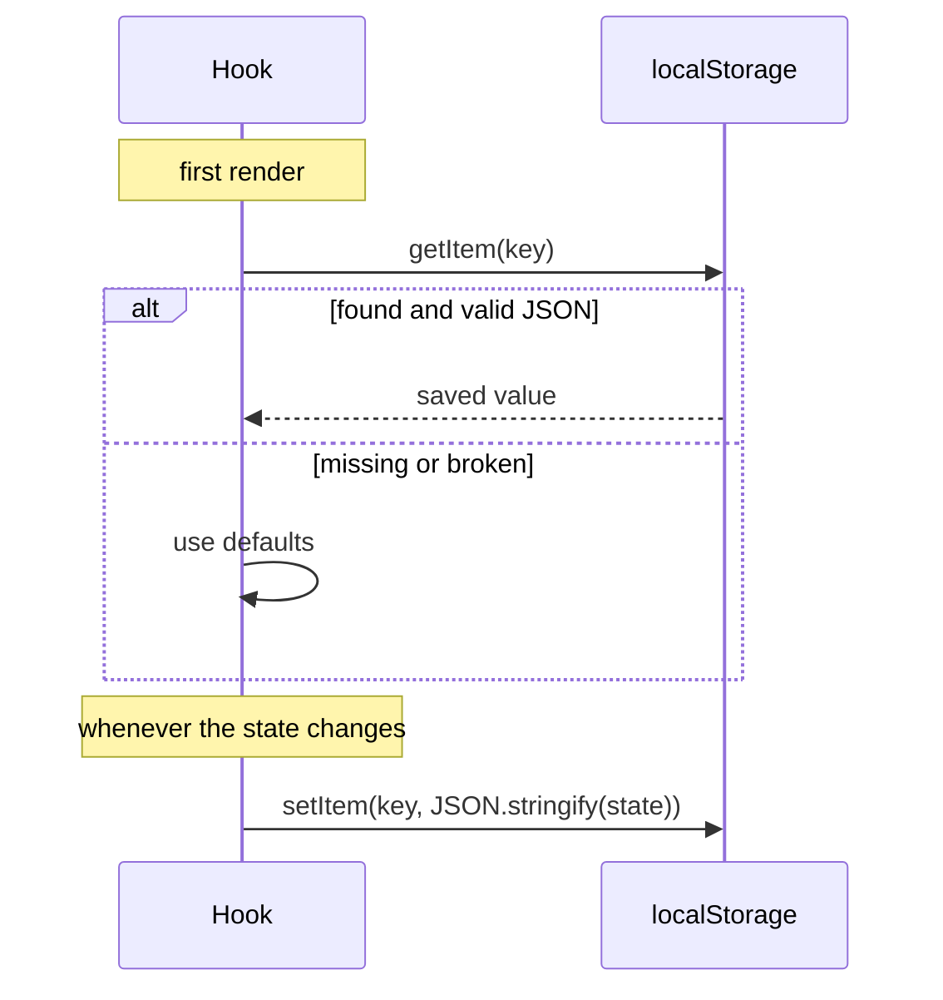
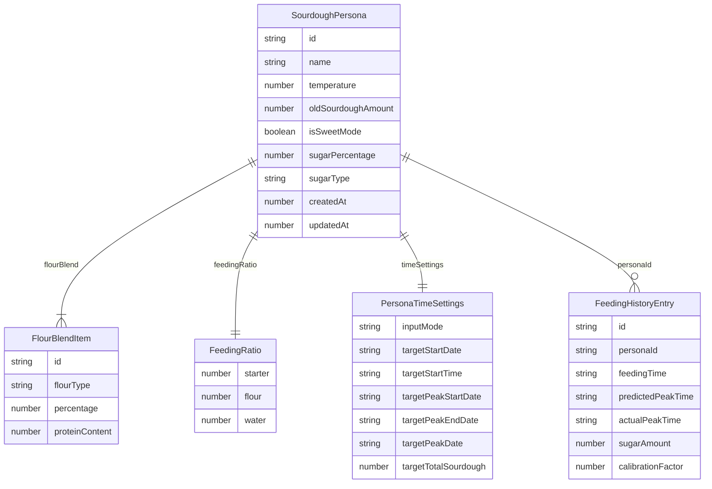

# Data and storage

The app has no database and no server. Everything the baker saves is stored in the browser's **`localStorage`**, a small key–value store that belongs to the website and survives reloads and restarts.

What that means in practice:

- Data stays on **one device and one browser**. A phone and a laptop each have their own starters.
- Clearing site data, or using a private window, starts from scratch.
- Nothing is sent anywhere. There are no accounts.

## The five keys

| `localStorage` key | Written by | Contains |
|---|---|---|
| `sourdough-personas` | [`use-personas.ts`](../src/hooks/use-personas.ts) | JSON array of starters (`SourdoughPersona[]`) |
| `sourdough-active-persona` | [`use-personas.ts`](../src/hooks/use-personas.ts) | The `id` of the selected starter (plain string) |
| `sourdough-feeding-history` | [`use-feeding-history.ts`](../src/hooks/use-feeding-history.ts) | JSON array of logged feeds, newest first, at most 50 |
| `sourdough-calculator-settings` | [`use-calculator-cache.ts`](../src/hooks/use-calculator-cache.ts) | JSON object with app settings |
| `sourdough-language` | [`i18n.tsx`](../src/lib/i18n.tsx) | `"en"` or `"da"` (plain string) |

Each hook follows the same pattern:

Reads and writes are wrapped in `try`/`catch`. If storage is blocked or full, the app logs a warning and keeps working without saving.

## What is saved

The diagram leaves out some fields to stay readable. The full types are below.

### Starter (`SourdoughPersona`)

In the code a starter is called a **persona** (see [Glossary](glossary.md)). Type in [`src/types/sourdough.ts`](../src/types/sourdough.ts).

| Field | Type | Example | Meaning |
|---|---|---|---|
| `id` | string | `"k3j9x2a"` | Random id from `generateId()` |
| `name` | string | `"Rye starter"` | Shown in the starter picker |
| `flourBlend` | `FlourBlendItem[]` | see below | Flours used to feed, should add up to 100 % |
| `feedingRatio` | `{ starter, flour, water }` | `{1, 5, 5}` | Parsed ratio |
| `ratioInputs` | `{ starter, flour, water }` (strings) | `{"1","5","5"}` | What the baker typed, so "1," survives while typing |
| `temperature` | number (°C) | `24` | 10–40 |
| `oldSourdoughAmount` / `oldSourdoughInput` | number / string | `50` / `"50"` | Grams of old starter |
| `isSweetMode` | boolean | `false` | Sweet sourdough switch |
| `sugarPercentage` | number | `5` | Sweetener as % of flour weight, 1–100 |
| `sugarType` | `SugarType` | `"honey"` | Key in `SUGAR_DATA` |
| `timeSettings` | `PersonaTimeSettings` | | Mode and times, see below |
| `createdAt`, `updatedAt` | number (ms since 1970) | | Timestamps |

`FlourBlendItem`: `{ id, flourType, percentage, proteinContent }`. `flourType` is a key in `FLOUR_DATA`. `proteinContent` is shown to the baker but [does not affect timing](fermentation-model.md#flour).

`PersonaTimeSettings`: `inputMode` (`'basic' | 'target-window' | 'total-sourdough'`), and dates as `YYYY-MM-DD` and times as `HH:MM` strings: `targetStartDate/Time`, `targetPeakStartDate/Time`, `targetPeakEndDate/Time` (Target Window), `targetPeakDate/Time` (Total Sourdough), plus `targetTotalSourdough` (number) and `targetTotalSourdoughInput` (string).

A new starter (`createDefaultPersona`) is bread flour 100 %, 1:1:1, 24 °C, 50 g, not sweet, 5 % white sugar ready if switched on, Normal mode starting now.

### Logged feed (`FeedingHistoryEntry`)

Type in [`src/hooks/use-feeding-history.ts`](../src/hooks/use-feeding-history.ts).

| Field | Type | Meaning |
|---|---|---|
| `id` | string | Random id |
| `personaId`, `personaName` | string | Which starter |
| `feedingTime`, `predictedPeakTime` | ISO date string | From the calculation |
| `actualPeakTime` | ISO date string or `null` | Recorded by the baker later |
| `peakTimeDifferenceMinutes` | number or `null` | Actual − predicted, positive = later than predicted |
| `temperature`, `feedingRatio`, `flourBlend` | | Inputs at the time |
| `starterAmount`, `flourAmount`, `waterAmount`, `sugarAmount` | number (g) | Amounts at the time. `sugarAmount > 0` marks a sweet feed |
| `notes` | string | Free text |
| `createdAt` | number | Timestamp |
| `calibrationFactor` | number, optional | Calibration the prediction used. Missing on older entries (treated as 1) |

Only the newest 50 entries are kept (`MAX_HISTORY_ENTRIES`). See [Calibration](calibration.md) for how they are used.

### Settings (`CalculatorSettings`)

Only `isDarkMode` is used today; it follows the device's dark-mode setting when the app opens. The other fields (`language`, `useTargetWindow` and target times) are left over from before starters had their own time settings. The language is saved under its own key, `sourdough-language`.

### Dates and times

Date and time inputs are stored as **local** strings: `YYYY-MM-DD` and `HH:MM`. Make dates with `format(date, 'yyyy-MM-dd')` from `date-fns`, **never** `date.toISOString().split('T')[0]`. `toISOString` gives the UTC date, which in Denmark is the previous day between midnight and 01:00 (winter) or 02:00 (summer); combined with the local time, the feed would land 24 hours in the past.

## Changing what is saved safely

Starters and history from older versions of the app are still in bakers' browsers. Code that reads them must accept old shapes.

**Do:**
- Add new fields as **optional** and give them a default where they are read (example: `calibrationFactor ?? 1`).
- Add new keys to `FLOUR_DATA` or `SUGAR_DATA` instead of renaming old ones.
- When a field must be filled in for old data, add a migration like the one at the end of `usePersonas` that adds `timeSettings` to starters that lack it.

**Don't:**
- Rename or remove a `FlourType` or `SugarType` key. Saved starters would point to a missing entry and the calculation would crash.
- Change the meaning of an existing field without a migration.
- Rename a `localStorage` key. Everyone would lose their starters.

### Example: an old key whose meaning changed

`spelt`, `kamut` and `einkorn` used to mean "spelt" in general. When whole-grain versions were added, the old keys were kept and now mean the **white** versions, while `spelt-whole`, `kamut-whole` and `einkorn-whole` were added. Saved starters still load; bakers using whole-grain flour switch to the new entry.

## Inspecting the data

In the browser: open the developer tools, go to **Application** (Chrome) or **Storage** (Firefox) → **Local Storage** → the site. You can read, edit or delete each key there. Deleting all five resets the app.
