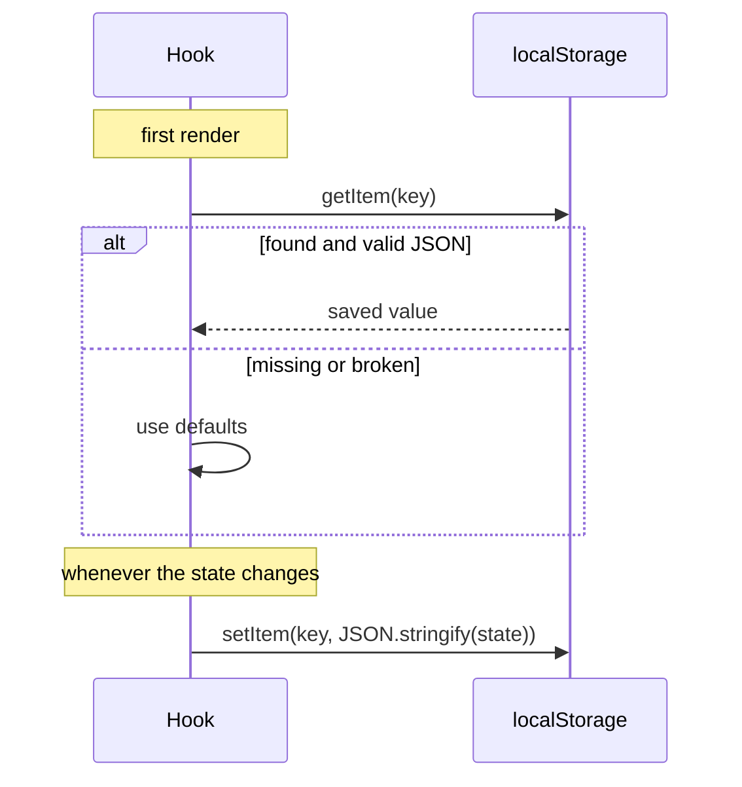
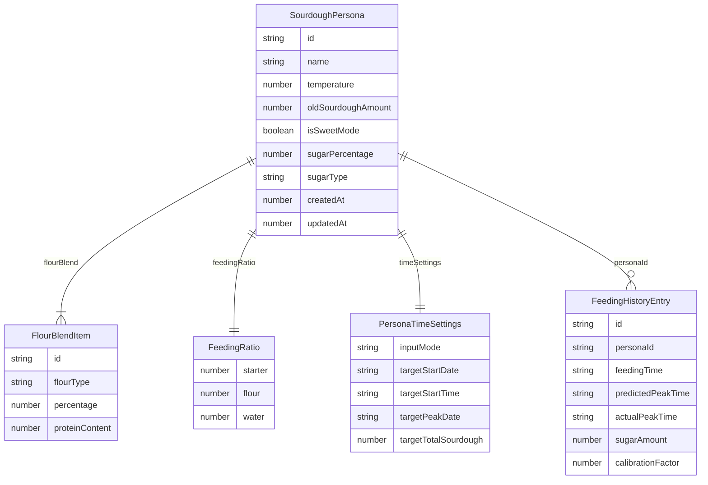

# Data and storage

The app has no database and no server. Everything the baker saves is stored in the browser's **`localStorage`**, a small key–value store that belongs to the website and survives reloads and restarts.

What that means in practice:

- Data stays on **one device and one browser**. A phone and a laptop each have their own starters.
- Clearing site data, or using a private window, starts from scratch.
- Nothing is sent anywhere. There are no accounts.

## When saved data disappears

**Deploying a new version never touches saved data.** A deploy replaces the files on the server; `localStorage` lives in the browser on the device and belongs to the site's *origin* (`https://bendfeldt.github.io`), which a deploy doesn't change. Starters disappear when the **browser** deletes them:

| What happens | Why the data is gone |
|---|---|
| The shortcut is removed from an iPhone/iPad home screen | iOS gives each home-screen app its own storage, separate from Safari, and deletes it with the shortcut. Adding the shortcut again starts empty |
| The app is used both in Safari and from the home screen (iOS) | They are two separate stores. Starters made in one are not visible in the other |
| The site isn't opened for 7 days of Safari use | Safari may delete storage of sites that haven't been visited (it doesn't do this to home-screen apps) |
| The device runs low on space | Browsers may clear storage they consider "best effort", oldest-used sites first |
| Site data or history is cleared, or a private window is used | The data is deleted along with it |

Cookies wouldn't help: they are cleared by the same rules, hold only about 4 KB, and would be sent to the server with every request for nothing. The app instead does two things, the usual approach for apps without a server:

1. **Asks the browser to keep the data.** On start, [`main.tsx`](../src/main.tsx) calls `keepSavedData()` in [`src/lib/saved-data.ts`](../src/lib/saved-data.ts), which calls `navigator.storage.persist()`. Storage the browser grants this to is not cleared when space runs low. Chrome and Safari decide without asking (usually yes for installed or often-used sites); Firefox may ask the user.
2. **Lets the baker save a backup.** Menu (☰) → **Backup** → **Save backup** writes all starters, the selected starter and the feeding history to a `sourdough-backup-YYYY-MM-DD.json` file. On phones this opens the share sheet, so the file can go to Files, iCloud, Google Drive or mail. **Restore** reads such a file back and, after a confirmation, replaces the starters and feeds on this device. This is also how to move starters between Safari and the home-screen app, or to another device.

The backup file looks like this:

```json
{
  "app": "sourdough-peak-planner",
  "version": 1,
  "exportedAt": "2026-10-13T08:00:00.000Z",
  "personas": [ … ],
  "activePersonaId": "k3j9x2a",
  "history": [ … ]
}
```

`parseBackup` refuses files without `"app": "sourdough-peak-planner"` or without a usable starter, drops entries it can't read, and the restored starters go through the same migration as stored ones, so backups from older versions still restore. Theme and language are not in the backup.

## The five keys

| `localStorage` key | Written by | Contains |
|---|---|---|
| `sourdough-personas` | [`use-personas.ts`](../src/hooks/use-personas.ts) | JSON array of starters (`SourdoughPersona[]`) |
| `sourdough-active-persona` | [`use-personas.ts`](../src/hooks/use-personas.ts) | The `id` of the selected starter (plain string) |
| `sourdough-feeding-history` | [`use-feeding-history.ts`](../src/hooks/use-feeding-history.ts) | JSON array of logged feeds, newest first, at most 50 per starter |
| `sourdough-calculator-settings` | [`use-theme.ts`](../src/hooks/use-theme.ts) | `{ "theme": "light" \| "dark" }` once the user presses the moon/sun button |
| `sourdough-language` | [`i18n.tsx`](../src/lib/i18n.tsx) | `"en"` or `"da"` (plain string) |

Each hook follows the same pattern:



Reads and writes are wrapped in `try`/`catch`. If storage is blocked or full, the app logs a warning and keeps working without saving.

## What is saved



The diagram leaves out some fields to stay readable. The full types are below.

### Starter (`SourdoughPersona`)

In the code a starter is called a **persona** (see [Glossary](glossary.md)). Type in [`src/types/sourdough.ts`](../src/types/sourdough.ts).

| Field | Type | Example | Meaning |
|---|---|---|---|
| `id` | string | `"k3j9x2a"` | Random id from `generateId()` |
| `name` | string | `"Rye starter"` | Shown in the starter picker |
| `flourBlend` | `FlourBlendItem[]` | see below | Flours used to feed, should add up to 100 % |
| `feedingRatio` | `{ starter, flour, water }` | `{1, 5, 5}` | Parsed ratio |
| `ratioInputs` | `{ starter, flour, water }` (strings) | `{"1","5","5"}` | What the baker typed, so "1," survives while typing |
| `temperature` | number (°C) | `24` | 10–40 |
| `oldSourdoughAmount` / `oldSourdoughInput` | number / string | `50` / `"50"` | Grams of old starter |
| `isSweetMode` | boolean | `false` | Sweet sourdough switch |
| `sugarPercentage` | number | `5` | Sweetener as % of flour weight, 1–100 |
| `sugarType` | `SugarType` | `"honey"` | Key in `SUGAR_DATA` |
| `timeSettings` | `PersonaTimeSettings` | | Mode and times, see below |
| `createdAt`, `updatedAt` | number (ms since 1970) | | Timestamps |

`FlourBlendItem`: `{ id, flourType, percentage, proteinContent }`. `flourType` is a key in `FLOUR_DATA`. `proteinContent` is shown to the baker but [does not affect timing](fermentation-model.md#flour).

`PersonaTimeSettings`: `inputMode` (`'basic' | 'weights' | 'total-sourdough'`), and dates as `YYYY-MM-DD` and times as `HH:MM` strings: `targetStartDate/Time`, `targetPeakDate/Time` (Total Sourdough), plus `targetTotalSourdough` (number) and `targetTotalSourdoughInput` (string).

Weights mode stores nothing of its own: the typed grams are saved as `oldSourdoughAmount` and `feedingRatio`. Starters saved before Weights mode may have `inputMode: 'target-window'` and four `targetPeakStart*`/`targetPeakEnd*` fields; `migratePersonas()` changes the mode to `'weights'` on load, and the old fields are ignored.

A new starter (`createDefaultPersona`) is bread flour 100 %, 1:1:1, 24 °C, 50 g, not sweet, 5 % white sugar ready if switched on, Normal mode starting now.

### Logged feed (`FeedingHistoryEntry`)

Type in [`src/hooks/use-feeding-history.ts`](../src/hooks/use-feeding-history.ts).

| Field | Type | Meaning |
|---|---|---|
| `id` | string | Random id |
| `personaId`, `personaName` | string | Which starter |
| `feedingTime`, `predictedPeakTime` | ISO date string | From the calculation |
| `actualPeakTime` | ISO date string or `null` | Recorded by the baker later |
| `peakTimeDifferenceMinutes` | number or `null` | Actual − predicted, positive = later than predicted |
| `temperature`, `feedingRatio`, `flourBlend` | | Inputs at the time |
| `starterAmount`, `flourAmount`, `waterAmount`, `sugarAmount` | number (g) | Amounts at the time. `sugarAmount > 0` marks a sweet feed |
| `createdAt` | number | Timestamp |
| `calibrationFactor` | number, optional | Calibration the prediction used. Missing on older entries (treated as 1) |

The newest 50 entries per starter are kept (`MAX_ENTRIES_PER_STARTER`), and deleting a starter deletes its entries. Older entries may also contain a `notes` field (always empty); it is ignored. See [Calibration](calibration.md) for how they are used.

### Theme

Only `theme` is read, and only once the user has pressed the moon/sun button; until then the app follows the device's dark mode, also when it changes. Older versions saved `isDarkMode` and other fields under this key on every visit, so they never meant a choice and are ignored. The language is saved under its own key, `sourdough-language`.

### Two tabs

Each store reloads when another tab of the app saves it (the browser's `storage` event), so two open tabs don't overwrite each other's starters or feeds.

### Dates and times

Date and time inputs are stored as **local** strings: `YYYY-MM-DD` and `HH:MM`. Make dates with `format(date, 'yyyy-MM-dd')` from `date-fns`, **never** `date.toISOString().split('T')[0]`. `toISOString` gives the UTC date, which in Denmark is the previous day between midnight and 01:00 (winter) or 02:00 (summer); combined with the local time, the feed would land 24 hours in the past.

## Changing what is saved safely

Starters and history from older versions of the app are still in bakers' browsers. Code that reads them must accept old shapes.

**Do:**
- Add new fields as **optional** and give them a default where they are read (example: `calibrationFactor ?? 1`).
- Add new keys to `FLOUR_DATA` or `SUGAR_DATA` instead of renaming old ones.
- When a field must be filled in for old data, add a migration like the one at the end of `usePersonas` that adds `timeSettings` to starters that lack it.

**Don't:**
- Rename or remove a `FlourType` or `SugarType` key. Saved starters would point to a missing entry and the calculation would crash.
- Change the meaning of an existing field without a migration.
- Rename a `localStorage` key. Everyone would lose their starters.

### Example: an old key whose meaning changed

`spelt`, `kamut` and `einkorn` used to mean "spelt" in general. When whole-grain versions were added, the old keys were kept and now mean the **white** versions, while `spelt-whole`, `kamut-whole` and `einkorn-whole` were added. Saved starters still load; bakers using whole-grain flour switch to the new entry.

## Inspecting the data

In the browser: open the developer tools, go to **Application** (Chrome) or **Storage** (Firefox) → **Local Storage** → the site. You can read, edit or delete each key there. Deleting all five resets the app. To check whether the browser granted persistent storage, run `await navigator.storage.persisted()` in the console.
