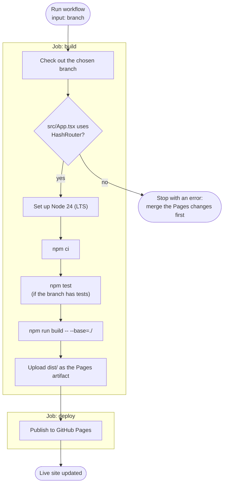

# Deployment

The app is published on **GitHub Pages**:

**<https://bendfeldt.github.io/sourdoughpeakplanner-ff7502f5/>**

The docs in `docs/` are part of the site too: menu (☰) → **Documentation**, or `…/#/docs/<page>`. They are built into the app, so deploying a branch also publishes that branch's docs.

GitHub Pages hosts static files: it sends the browser whatever files you give it and runs no code on the server. That fits this app, which is a static build with everything running in the browser.

## How to deploy

Deploys are started by hand, and **you choose which branch** to publish:

1. On GitHub, open **Actions**.
2. Select **Deploy to GitHub Pages** in the list on the left.
3. Press **Run workflow**. Leave **Use workflow from** on `main`, type the branch to publish in the **branch** box (default `main`) and press **Run workflow** again.
4. After a minute or two the site shows that branch. The run's summary has a link to it.

Publishing a feature branch is a good way to try a change on your phone before merging. Remember to deploy `main` again afterwards, so the public site shows the released version.

## What the workflow does

File: [`.github/workflows/deploy-pages.yml`](../.github/workflows/deploy-pages.yml). A separate workflow, [`checks.yml`](../.github/workflows/checks.yml), runs the same tests plus type check, lint and build on every pull request.

- **Two different branches are involved.** The *workflow file* comes from the branch in GitHub's "Use workflow from" menu, which defaults to `main` and can stay there. The *app code* comes from the branch you type in the **branch** box. GitHub only shows the **Run workflow** button once the workflow file is on `main`.
- **Tests must pass** for the deploy to go ahead.
- **Only one deploy runs at a time** (`concurrency: pages`). A second one waits for the first.
- The `github-pages` environment is the one GitHub creates when Pages is set to deploy from Actions.

## Why the URLs have a `#`

Pages serves the site from a sub-folder, `/sourdoughpeakplanner-ff7502f5/`, not from the root of the domain, and it cannot send every URL to `index.html` the way a configured server can. Two settings deal with that:

| Setting | File | Without it |
|---|---|---|
| `base: "./"` (and `--base=./` in the workflow) | [`vite.config.ts`](../vite.config.ts) | The page asks for `/assets/index.js` at the root of `bendfeldt.github.io` and gets a 404, so you see a blank page |
| `HashRouter` | [`src/App.tsx`](../src/App.tsx) | Opening or reloading `/sourdoughpeakplanner-ff7502f5/guidance` gives GitHub's 404 page, because no such file exists |

With `HashRouter`, the route lives after the `#` (`…/#/guidance`). The browser never sends that part to the server, so the server always serves `index.html` and React shows the right page.

That is also why links inside the app use React Router's `<Link to="/">` rather than `<a href="/">`: a plain link to `/` would leave the app for the root of `bendfeldt.github.io`.

## One-time setup (already done)

For reference, if the repository is ever moved or recreated:

1. The repository must be **public**, or the account needs a paid GitHub plan for Pages on a private repository.
2. **Settings → Pages → Build and deployment → Source: GitHub Actions.**
3. The workflow file must be on `main`.

## Troubleshooting

| Symptom | Cause and fix |
|---|---|
| No **Run workflow** button | The workflow file is not on `main` |
| `deploy` fails within a second, with no log | **Use workflow from** was set to another branch. Only `main` may deploy to the `github-pages` environment, so GitHub refuses the job. Run it again with **Use workflow from** on `main` and the branch typed in the **branch** box |
| Run fails at "Check the branch can run on GitHub Pages" | The branch was created before the Pages change. Merge `main` into it |
| Run fails at `npm test` | Fix the failing test on that branch; the site keeps the previous version |
| Blank page, 404s for `.js`/`.css` in the browser console | Asset paths are absolute. Check `base: "./"` in `vite.config.ts` |
| A page works from the menu but 404s on reload | The branch uses `BrowserRouter` instead of `HashRouter` |
| Old version still showing | Hard-reload (Ctrl/Cmd + Shift + R); the browser cached the old files |
