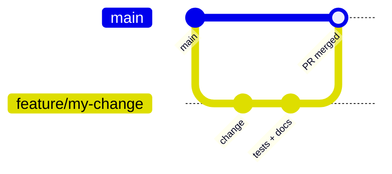

# Development

How to run the app, test it, and make the most common changes.

## Setup

You need **Node.js 24** (the current LTS) or newer, and npm, which comes with Node. `package.json` sets `"engines": { "node": ">=24" }`.

```sh
git clone https://github.com/bendfeldt/sourdoughpeakplanner-ff7502f5.git
cd sourdoughpeakplanner-ff7502f5
npm ci          # install the exact versions from package-lock.json
npm run dev     # start the dev server
```

Open <http://localhost:8080>. The page reloads when you save a file.

> **`EAFNOSUPPORT` error?** `vite.config.ts` listens on `::` (IPv6). On machines without IPv6, run `npx vite --host 127.0.0.1` instead.

## Scripts

| Command | What it does |
|---|---|
| `npm run dev` | Dev server with live reload on port 8080 |
| `npm test` | Runs the calculator tests with Node's built-in test runner |
| `npm run lint` | ESLint over the whole project |
| `npx tsc -p tsconfig.app.json --noEmit` | Type check without building |
| `npm run build` | Production build into `dist/` |
| `npm run preview` | Serves `dist/` locally (add `--host 127.0.0.1` if needed) |

### Before you open a pull request

Run these and make sure the first three pass:

```sh
npm test
npx tsc -p tsconfig.app.json --noEmit
npm run build
npm run lint
```

`npm run lint` currently reports 55 errors that already exist on `main`, all `no-explicit-any` from `t('key' as any)` in the components. **Don't add new ones.** To compare, run lint on `main` and on your branch.

## Tests

The tests live next to the code they test: [`src/lib/sourdough-calculator.test.ts`](../src/lib/sourdough-calculator.test.ts) for the calculator and [`src/lib/docs.test.ts`](../src/lib/docs.test.ts) for the docs pages. They use **`node:test`** and **`node:assert`**, which are built into Node, so there is no test framework to install. Node 24 runs TypeScript files directly by stripping the types, which is why the test imports end in `.ts`. TypeScript 6 no longer loads `@types` packages on its own, so `tsconfig.app.json` lists `"types": ["node"]` for the tests.

```sh
npm test
```

What is covered:

| Test | Checks |
|---|---|
| reference feeds match the calibration points | 3.5 h for 1:1:1, 9.2 h for 1:5:5, 13.9 h for 1:10:10 |
| temperature | fastest at 30–31 °C, slower above, no peak at 38 °C |
| stiff vs liquid | lower hydration is slower |
| sugar threshold | 2 % sugar has no effect, threshold at 5 % in the water |
| sugar up to the weight of flour | slowdown grows, 1:1:1:1 is 10×, a stiff syrup-like starter does not peak |
| stiff starter and sugar | same sugar slows a stiff starter more |
| honey and maple syrup | their water is taken off the feeding water |
| ratio solver | recommended ratio gives back the target time |
| unreachable window | warns instead of faking the peak |
| old flour keys | saved starters with `spelt`, `kamut`, `einkorn` still calculate |
| calibration | settles on the true factor; sweet and plain feeds kept apart |
| docs links (`docs.test.ts`) | every file in `docs/` is in the menu, and every link and `#section` inside the docs points to a real page and heading |

To add a test, copy an existing `test('…', () => { … })` block. The `input()` helper at the top builds a reference feed (all-purpose, 1:1:1, 24 °C) and you override only what matters:

```ts
test('rye is faster than white flour', () => {
  const rye = calculateFermentationTime(input({
    flourBlend: [{ id: 'r', flourType: 'rye', percentage: 100, proteinContent: 9 }],
  }));
  assert.ok(rye < 3.5);
});
```

React components have no tests. Check UI changes by running the app (see [Checking a change in the browser](#checking-a-change-in-the-browser)).

## Branches and pull requests

`main` is **protected**: changes go in through pull requests.



1. Create a branch from the latest `main`.
2. Make the change, with tests and doc updates.
3. Run the checks above.
4. Push the branch and open a pull request.
5. Optional: deploy your branch to GitHub Pages to try it on a phone (see [Deployment](deployment.md)).

## Common changes

### Add a flour type

1. Add the key to `FlourType` in [`src/types/sourdough.ts`](../src/types/sourdough.ts), for example `'rye-white'`.
2. Add an entry to `FLOUR_DATA` in [`src/lib/sourdough-calculator.ts`](../src/lib/sourdough-calculator.ts) with `name`, `baseProtein`, `fermentationModifier` and `description`. Choose the modifier by how much whole grain the flour contains; compare with the [flour table](fermentation-model.md#flour).
3. Add the name (`'rye-white'`) and description (`'rye-white-desc'`) to **both** `en` and `da` in [`src/lib/i18n.tsx`](../src/lib/i18n.tsx).
4. Add the row to the flour table in [`docs/fermentation-model.md`](fermentation-model.md#flour).

The flour picker lists every key in `FLOUR_DATA` automatically.

### Add a sweetener

1. Add the key to `SugarType` in [`src/types/sourdough.ts`](../src/types/sourdough.ts).
2. Add an entry to `SUGAR_DATA` with `sugarFraction` and `waterFraction` (shares of the sweetener's weight; look up the composition) and a `description`.
3. Add the name to both languages in `i18n.tsx`.
4. Add the row to the sweetener table in [`docs/fermentation-model.md`](fermentation-model.md#sugar).

### Add or change a text

Every visible text is a key in `translations.en` and `translations.da` in [`src/lib/i18n.tsx`](../src/lib/i18n.tsx). Add the key to both, then use `t('yourKey')` in the component. TypeScript knows the English keys, so a typo in `t('…')` is a type error unless it is written with `as any`.

### Change the model

Read [Fermentation model → Rules for changing the model](fermentation-model.md#rules-for-changing-the-model) first. In short: change constants or factors inside `conditionsFactor()` so the prediction and the solver stay in step, keep the reference feed at 3.5 h, add a test, and update the docs tables.

### Add a docs page

1. Write `docs/<name>.md`. Start it with one `# Title` line.
2. Add `{ slug: '<name>', file: '<name>', title: '…' }` to `DOC_PAGES` in [`src/lib/docs.ts`](../src/lib/docs.ts), in the order it should appear in the menu.
3. Link to it from [`docs/README.md`](README.md).
4. Run `npm test`. It fails if a file is missing from `DOC_PAGES` or a link points to a heading that doesn't exist.

Links in the docs are written the GitHub way (`calibration.md#sugar`, `#tests`, `../src/App.tsx`); the app turns them into its own routes, or into links to the file on GitHub.

### Add a new tip

1. Push a new key onto `suggestions` in `calculateFeedingSchedule`.
2. Add the text to both languages.
3. Add it to the tips table in [`docs/calculation-modes.md`](calculation-modes.md#tips-suggestions).

## Checking a change in the browser

`npm run dev`, then try:

- Normal mode with 1:1:1 at 24 °C → peak 3.5 h after the start time.
- Temperature at 40 °C → "No normal peak expected within 48 hours".
- Sweet sourdough with honey → water is a little lower, and "+… min from sugar" appears.
- Target Window 1 h away → red "Target time not achievable" box.
- Log a feed, record a later actual peak, and calculate again → the peak moves later.
- Switch to Dansk and reload → still Danish, also on the guidance page.

## Updating the docs

The tables in [`fermentation-model.md`](fermentation-model.md) and [`calculation-modes.md`](calculation-modes.md) were produced by running the calculator. After changing a constant, regenerate the numbers with a small script and update the tables and charts. For example:

```sh
cat > /tmp/numbers.mts <<'EOF'
import * as c from './src/lib/sourdough-calculator.ts';
for (const t of [10, 15, 20, 24, 28, 30, 32, 35, 36, 37, 38]) {
  console.log(t, c.temperatureFactor(t).toFixed(2), (3.5 * c.temperatureFactor(t)).toFixed(1) + ' h');
}
EOF
cp /tmp/numbers.mts ./numbers.mts && node numbers.mts; rm numbers.mts
```

Diagrams are Mermaid code blocks. GitHub draws them; to preview locally, paste a block into <https://mermaid.live>.

## Known issues

| Issue | Where |
|---|---|
| `npm run lint` reports existing `no-explicit-any` errors | `t('key' as any)` calls |
| `npm audit` reports warnings in build tools only | `lovable-tagger` (dev-only Lovable plugin) still pulls in Tailwind 3 internals, and `@tailwindcss/typography` an older CSS parser. Nothing reaches the built site |
| Settings hook still stores unused fields | `use-calculator-cache.ts` |
