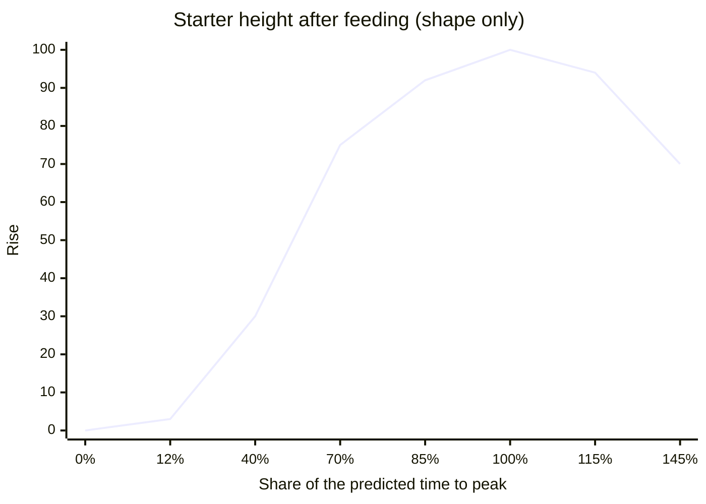
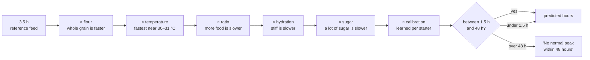
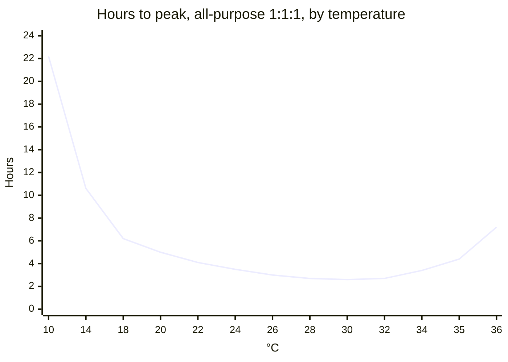
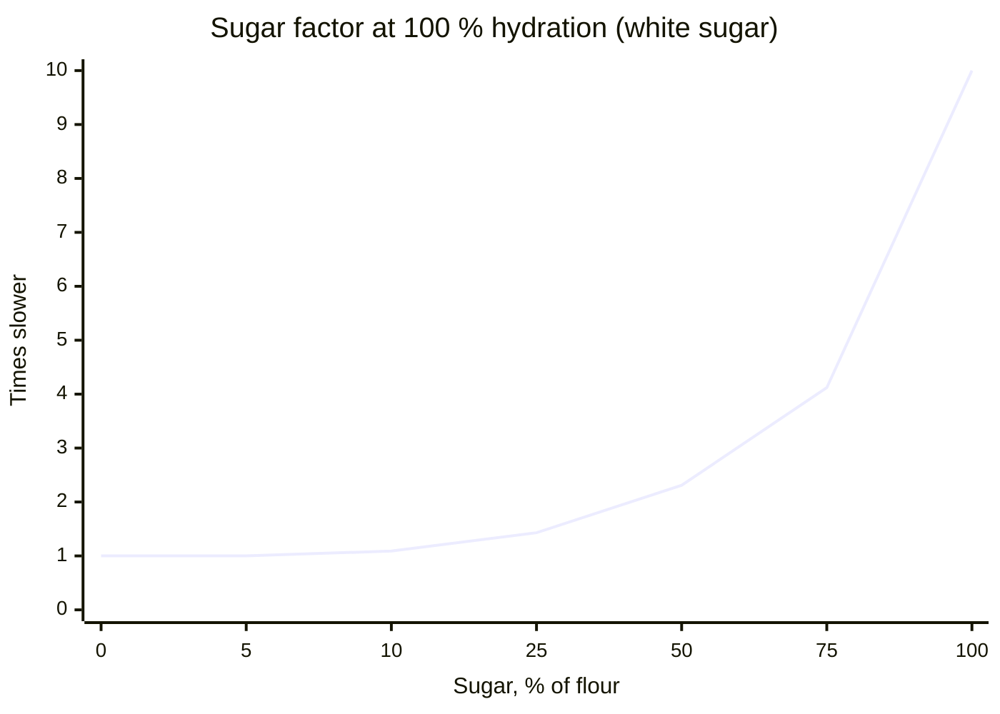

# Fermentation model

This page explains how the app predicts **the time from feeding until the starter peaks**, why each part of the formula exists, and where it lives in the code. All of it is in [`src/lib/sourdough-calculator.ts`](../src/lib/sourdough-calculator.ts).

## Background: what is a "peak"?

A sourdough starter is flour and water full of wild **yeast** and **lactic acid bacteria (LAB)**. When you feed it fresh flour and water, the microbes:

1. **Adapt** to the new food for a while (the *lag* phase).
2. **Multiply** and produce gas (CO₂), so the starter **rises**.
3. Run short of easy food. The rise **levels off** at its highest point: the **peak**.
4. **Fall back** as the bubbles escape.

Bakers want to use the starter at its peak, when it is most active. The app predicts the **middle of that level stretch** (the plateau).



The timeline in the app uses the same shares: lag 0–12 %, rise 12–85 %, peak 85–115 %, decline 115–145 % of the predicted time (`generateFermentationPhases`).

## The formula

```text
hours to peak = 3.5 h × flour × temperature × ratio × hydration × sugar × calibration
```

`3.5 h` is the **reference feed**: all-purpose flour, ratio 1:1:1 (starter : flour : water by weight), 24 °C, no sugar. Every other part is a **multiplier** that is exactly `1.0` for the reference feed:

- more than 1 means slower (later peak),
- less than 1 means faster (earlier peak).



Results under 1.5 h are raised to 1.5 h (`MIN_FERMENTATION_HOURS`), because shorter predictions are not trustworthy. Results over 48 h (`MAX_FERMENTATION_HOURS`) set `exceedsMaxHours` in the result, and the app says no normal peak is expected instead of showing a time.

### Why multiply?

Each factor changes how **fast** the microbes work. If a warmer room makes them 1.3× faster and whole-grain flour makes them 1.5× faster, both together make them about 2× faster. Speeds combine by multiplying, so times do too. Because every factor is independent, you can change one without touching the others.

### Worked example

50 g starter fed 1:5:5 at 21 °C with 80 % bread flour and 20 % whole wheat, no sugar, no calibration yet:

| Part | Value | Why |
|---|---|---|
| base | 3.5 h | reference feed |
| flour | 0.80 × 1.00 + 0.20 × 0.65 = **0.93** | weighted by blend share |
| temperature | **1.30** | 21 °C is a bit cool |
| ratio | 5^0.6 = **2.63** | 5 parts flour per part starter |
| hydration | **1.00** | 100 % hydration (water = flour) |
| sugar | **1.00** | none |
| calibration | **1.00** | no logged feeds yet |
| **result** | 3.5 × 0.93 × 1.30 × 2.63 ≈ **11.1 h** | |

The app also tells the baker to add 250 g flour and 250 g water, for 550 g in total.

## The factors one by one

### Flour

Whole-grain flour ferments faster than white flour. The bran and germ bring minerals, enzymes, natural sugars and more microbes. Research on flour extraction rate (how much of the grain ends up in the flour) and ash (mineral) content shows microbial growth and acid production both go up with it. **Protein content does not speed fermentation**, so the protein the baker enters is shown but not used in the timing.

The flour factor is the average of each flour's `fermentationModifier` in `FLOUR_DATA`, weighted by its percentage of the blend (`blendedFermentationModifier`).

| Flour key | Factor | Notes |
|---|---|---|
| `rye` | 0.50 | Fastest. Rises less visibly than wheat |
| `whole-wheat`, `fuldkornsmel`, `spelt-whole`, `einkorn-whole` | 0.65 | Whole grain |
| `kamut-whole` | 0.70 | Whole grain |
| `oat-flour` | 0.80 | Whole grain, no gluten |
| `oland-wheat` | 0.85 | Usually stone-ground with some bran |
| `spelt`, `einkorn` | 0.90 | Sifted (white) versions |
| `kamut` | 0.95 | Sifted |
| `all-purpose`, `bread-flour`, `danish-wheat`, `manitoba`, `tipo-0`, `durum`, `semolina` | 1.00 | Refined |
| `tipo-00` | 1.05 | The most refined, least bran |

> The values are informed estimates. No study measures them precisely for starters. Their **order** is well supported, the exact numbers less so.

`spelt`, `kamut` and `einkorn` are the **white** versions. They existed before the whole-grain versions were added, and their keys were kept so that starters saved in the browser still load.

### Temperature

Microbes grow faster when warm, up to a point. In sourdough, the yeast grows best at about 27–28 °C and stops at about 35–36 °C. The bacteria grow best at about 32–33 °C (Gänzle et al. 1998). The rise mostly comes from the yeast, so the starter is fastest in between, around 30–31 °C, and slows down sharply above 35 °C.

The app uses the **extended Ratkowsky model**, a standard model in food microbiology for growth rate against temperature:

```text
√rate = (T − 1) × (1 − e^(0.3 × (T − 38)))
temperature factor = rate(24 °C) ÷ rate(T)
```

`T_MIN = 1`, `T_MAX = 38` and `T_C = 0.3` were fitted to the published optimum temperatures. At or above 38 °C the rate is zero, so the factor is infinite and the app says there is no normal peak.

| °C | 10 | 15 | 18 | 20 | 22 | 24 | 26 | 28 | 30 | 31 | 32 | 34 | 35 | 36 | 37 | 38 |
|---|---|---|---|---|---|---|---|---|---|---|---|---|---|---|---|---|
| factor | 6.34 | 2.62 | 1.78 | 1.43 | 1.18 | 1.00 | 0.87 | 0.78 | 0.74 | 0.74 | 0.77 | 0.97 | 1.26 | 2.06 | 5.90 | ∞ |
| 1:1:1 AP | 22.2 h | 9.2 h | 6.2 h | 5.0 h | 4.1 h | 3.5 h | 3.0 h | 2.7 h | 2.6 h | 2.6 h | 2.7 h | 3.4 h | 4.4 h | 7.2 h | 20.6 h | none |



The temperature slider goes from 10 to 40 °C. The app adds tips: below 18 °C "slower but more flavourful", 28–33 °C "faster but less complex", above 35 °C "the yeast struggles".

> Earlier versions used "twice as fast every 8 °C" for all temperatures. That matches the new curve between about 18 and 28 °C, but it claimed 40 °C was the fastest temperature of all.

### Feeding ratio

The ratio is written **starter : flour : water** by weight. 1:5:5 means 5 g flour and 5 g water for every 1 g of starter. More food per starter means the microbes need more time to use it up, so the peak comes later.

```text
ratio factor = (flour ÷ starter) ^ 0.6
```

| Ratio | 1:0.5:0.5 | 1:1:1 | 1:2:2 | 1:3:3 | 1:5:5 | 1:10:10 | 1:15:15 |
|---|---|---|---|---|---|---|---|
| hours (AP, 24 °C) | 2.3 | 3.5 | 5.3 | 6.8 | 9.2 | 13.9 | 17.8 |

The exponent 0.6 is a **curve fit** to what bakers report from 1:1:1 to 1:10:10, not a law of nature. Below 0.5 parts flour the factor stops changing (`MIN_FLOUR_PER_STARTER`). The ratio solver (see [Calculation modes](calculation-modes.md)) only recommends ratios between 1:0.5 and 1:15.

### Hydration

**Hydration** is water divided by flour, by weight. 100 % means equal weights. A **stiff** starter (50–60 %) ferments more slowly than a liquid one.

```text
hydration factor = (1 ÷ hydration) ^ 0.25
```

| Hydration | 50 % | 60 % | 75 % | 100 % | 125 % | 150 % |
|---|---|---|---|---|---|---|
| factor | 1.19 | 1.14 | 1.07 | 1.00 | 0.95 | 0.90 |

Studies show hydration mainly changes which acids form (stiffer means more acetic acid). How much it changes speed has not been measured, so the exponent 0.25 is deliberately mild. Hydration below 40 % is treated as 40 %.

### Sugar

Some bakers add sugar to a starter, for example before a sweet dough. Sugar has two effects:

- **A little sugar is extra food.** The usual sourdough yeast cannot use maltose, the main sugar flour releases, but it can use table sugar, glucose and fructose. Small amounts do not slow the starter.
- **A lot of sugar pulls water out of the microbes** (osmotic stress). Growth slows down steadily as sugar rises (Narendranath & Power 2005), and stops at around syrup strength.

What matters is **how much sugar is dissolved in the starter's water**, not its share of the flour:

```text
sugar in water = sugar ÷ (water + sugar)          (by weight, sugar solids only)
slowdown       = (sugar in water − 5 %) ÷ (55 % − 5 %)     (0 if below 5 %)
sugar factor   = 1 ÷ (1 − slowdown)               (infinite when slowdown ≥ 1)
```

- `SUGAR_THRESHOLD = 0.05`: below 5 % sugar in the water there is no slowdown.
- `SUGAR_LIMIT = 0.55`: at 55 % sugar in the water the starter stops growing.

Because the formula looks at sugar in the **water**, the same amount of sugar slows a stiff starter much more than a liquid one.

Factor for white sugar, by sugar as % of flour and starter hydration:

| Sugar % of flour → | 2 % | 5 % | 10 % | 25 % | 50 % | 100 % | No slowdown up to |
|---|---|---|---|---|---|---|---|
| 50 % hydration | 1.00 | 1.09 | 1.30 | 2.31 | 10.0 | stops | 2.6 % |
| 75 % hydration | 1.00 | 1.03 | 1.16 | 1.67 | 3.33 | stops | 3.9 % |
| 100 % hydration | 1.00 | 1.00 | 1.09 | 1.43 | 2.31 | 10.0 | 5.3 % |
| 125 % hydration | 1.00 | 1.00 | 1.05 | 1.30 | 1.89 | 4.74 | 6.6 % |



The sugar slider goes from 1 % to 100 % of the flour weight, so a 1:1:1:1 feed (starter, flour, water, sugar) is possible: about 10× slower, 35 h for all-purpose flour at 24 °C.

**Sweeteners are not all sugar.** `SUGAR_DATA` stores what each one is made of:

| Sweetener | Sugar | Water |
|---|---|---|
| `white-sugar` | 100 % | 0 % |
| `cane-sugar` | 99.5 % | 0 % |
| `powdered-sugar` | 97 % (rest is starch) | 0 % |
| `brown-sugar` | 97 % | 2 % |
| `honey` | 82 % | 17 % |
| `maple-syrup` | 67 % | 32 % |

Only the sugar part counts in the formula. The water part is **subtracted from the water the baker adds**, so the starter keeps the hydration they chose. Example: 50 g flour, 1:1:1, honey at 20 % of flour → 10 g honey, and 48 g water instead of 50 g. The app shows the extra time the sugar causes ("+47 min from sugar") as `sugarDelayMinutes`.

> The 5 % threshold and 55 % limit are informed estimates. The straight-line fall in growth is measured for lactobacilli in sugar solutions. The exact values for a starter are not. [Calibration](calibration.md) keeps a separate correction for feeds with sugar for this reason.

### Calibration

A per-starter multiplier learned from feeds the baker logged, between 0.6 and 1.6. It is `1.0` until the baker records actual peak times. See [Calibration](calibration.md).

## Where each piece is in the code

| What | Name in `sourdough-calculator.ts` |
|---|---|
| Reference time | `BASE_FERMENTATION_HOURS = 3.5`, `REFERENCE_TEMPERATURE = 24` |
| Limits | `MIN_FERMENTATION_HOURS = 1.5`, `MAX_FERMENTATION_HOURS = 48` |
| Flour table | `FLOUR_DATA`, `blendedFermentationModifier()` |
| Temperature | `T_MIN`, `T_MAX`, `T_C`, `temperatureFactor()` |
| Ratio | `ratioFactor()`, `MIN_FLOUR_PER_STARTER = 0.5`, `MAX_FLOUR_PER_STARTER = 15` |
| Hydration | `HYDRATION_EXPONENT = 0.25`, `hydrationFactor()` |
| Sugar | `SUGAR_DATA`, `SUGAR_THRESHOLD`, `SUGAR_LIMIT`, `sugarConcentration()`, `sugarFactor()` |
| Calibration limits | `CALIBRATION_MIN = 0.6`, `CALIBRATION_MAX = 1.6` |
| Everything except the ratio | `conditionsFactor()` |
| Full prediction | `rawFermentationHours()` (unclamped), `calculateFermentationTime()` (clamped) |

`conditionsFactor()` is shared by the prediction and by the ratio solver `calculateRequiredRatio()`. **Always change the model there**, never in only one of them. They used to be two copies that drifted apart.

## Rules for changing the model

1. **Keep the reference feed at 3.5 h.** Every factor must be exactly `1.0` for all-purpose flour, 1:1:1, 24 °C, no sugar. The test "reference feeds match the calibration points" checks this.
2. **Factors must not depend on each other**, except sugar, which reads the hydration on purpose.
3. **Saved starters must keep loading.** Never remove or rename a key in `FLOUR_DATA` or `SUGAR_DATA`. Add new keys instead.
4. **Run `npm test`** and add a test for the behaviour you changed.
5. **Update this page.** The tables were produced by running the calculator; see [Development → Updating the docs](development.md#updating-the-docs).

## What the model does not include

These were considered and left out on purpose:

| Not modelled | Why |
|---|---|
| Sugar speeding the starter up at very low amounts | Real, but small in a starter (flour already provides sugar) and not measured |
| A different curve shape for the ratio | The 0.6 power curve fits 1:1 to 1:10 well |
| Flour protein | Does not measurably change fermentation speed |
| Starter age, strength or microbes | Different for every starter. Calibration absorbs it |
| Salt, other ingredients | Not part of starter feeding |

## Sources

- Gänzle, Ehmann & Hammes (1998), *Modeling of growth of Lactobacillus sanfranciscensis and Candida milleri in response to process parameters of sourdough fermentation*, Applied and Environmental Microbiology 64(7). Optimum temperatures of sourdough yeast and bacteria. [PMC106434](https://pmc.ncbi.nlm.nih.gov/articles/PMC106434)
- Ratkowsky et al. (1983), extended square-root model for bacterial growth against temperature, Journal of Bacteriology 154(3).
- Narendranath & Power (2005), lactobacilli growth rates fall linearly with dissolved sugar. [SGD reference](https://www.yeastgenome.org/reference/15870306)
- *Fructilactobacillus sanfranciscensis*: maltose use, fructose as electron acceptor, partner yeast that cannot use maltose. [Wikipedia](https://en.wikipedia.org/wiki/Fructilactobacillus_sanfranciscensis)
- Flour extraction rate and ash content raise sourdough microbial growth and acidification. [IFSTRJ article](https://ifstrj.um.ac.ir/article_35873.html?lang=en)
- Sourdough review on flour, buffering and fermentation. [PMC6812221](https://pmc.ncbi.nlm.nih.gov/articles/PMC6812221)
